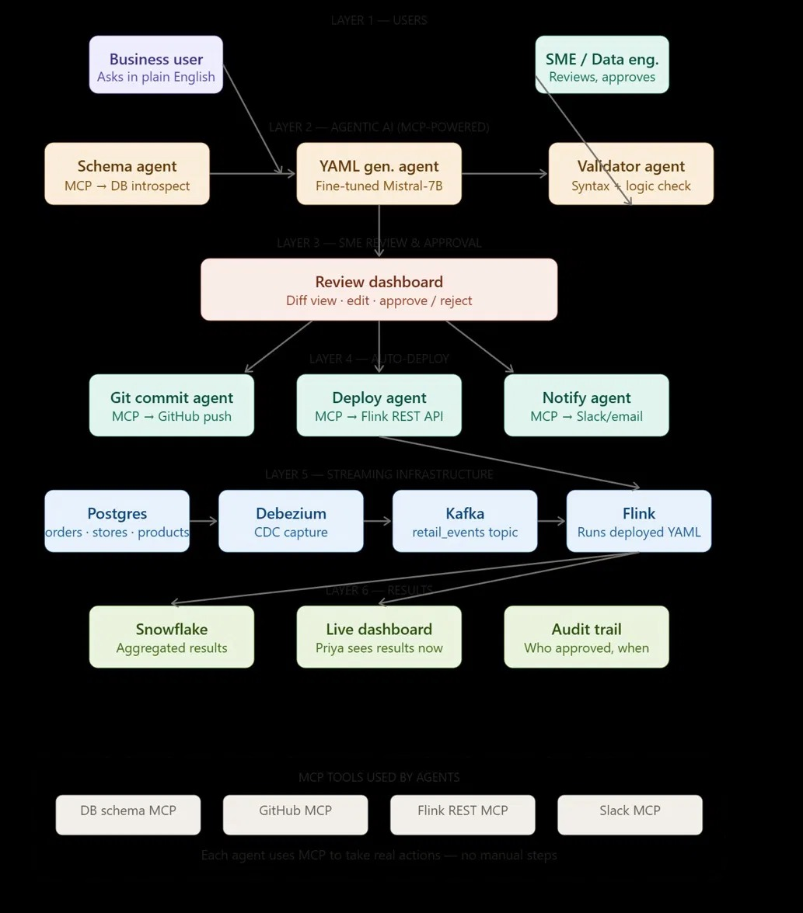

# nl2flink / MegaStore Pulse — AI Pipeline Studio

> **Ask in plain English. Get a production streaming pipeline.**
> A fine-tuned 14B LLM and an agentic MCP system that translate natural-language business questions into validated, production-ready Apache Flink pipelines — with a human engineer in the loop and fully automated deployment.

---

## Architecture Diagram

### 6-Layer Agentic Architecture


---

## The Problem

In most data teams, real-time analytics is locked behind a small group of streaming engineers.

When a business user wants a live answer — *"sales by category in the last 10 minutes,"* *"alert me when returns spike in any region"* — they can't get it themselves. Someone has to hand-write a streaming pipeline: define the Flink job, wire up the Kafka topics, configure the CDC source, get the windowing and aggregation syntax exactly right, test it, and deploy it.

That creates four problems:
- **It's slow.** A single pipeline takes hours of engineering time from request to live data.
- **It's a bottleneck.** Only one or two people on the team can write these pipelines, so requests queue up and throughput is capped at a handful per week.
- **It's fragile.** When the person who knows the streaming stack is unavailable, *nothing ships* — a bus factor of one.
- **It's gated by expertise.** Business users understand the question; they don't know Flink, Kafka, CDC, or YAML. The knowledge gap is the wall.

The result: the people who need real-time data are blocked, and the people who can deliver it are buried.

---

## The Solution

**nl2flink / MegaStore Pulse** removes the bottleneck without removing the safety net.

A business user asks a question in plain English. A **fine-tuned 14B-parameter LLM** generates a production-grade Flink pipeline definition. A chain of **agents** introspects the live database schema, validates the output, and self-corrects on failure. A **human engineer reviews and approves** the generated pipeline before anything goes live — and once approved, **MCP agents deploy it automatically** to the streaming stack and notify the requester.

The business user self-serves. The engineer reviews instead of writes. Real-time pipelines that used to take hours ship in minutes — and the bus-factor problem disappears, because the knowledge now lives in the model, not in one person's head.

---

## Repository Directory Structure

```
Nl2flink/
├── README.md
├── requirements.txt
├── .env.example              # every setting the backend reads
│
├── backend/                  # FastAPI backend — all real, no mocks
│   ├── config.py             # every server endpoint in one Settings class
│   ├── pipeline_spec.py      # pydantic model of the YAML the fine-tuned model emits
│   ├── database.py           # pipeline_requests table + the status flow
│   ├── api_models.py         # API request/response models (plain JSON, no HTML)
│   ├── dependencies.py       # the shared services the routers use
│   ├── main.py               # the FastAPI app
│   ├── routers/
│   │   ├── auth_routes.py
│   │   ├── business_routes.py    # ask, status, answer, history
│   │   ├── engineer_routes.py    # review, edit, approve (SSE), reject, deployed
│   │   └── monitor_routes.py     # Flink metrics, CDC events, platform + MCP health
│   ├── services/
│   │   ├── stack_clients.py      # postgres · debezium · kafka · flink · snowflake · slack · github
│   │   ├── model_generator.py    # the fine-tuned model server
│   │   ├── pipeline_validator.py # schema + semantics + compilation checks
│   │   ├── flink_sql_builder.py  # pipeline DSL -> Flink SQL
│   │   └── answer_reader.py      # Snowflake results -> the answer card
│   └── agents/
│       ├── mcp_client.py         # LangGraph MCP adapter
│       ├── pipeline_agent.py     # ground -> generate -> validate -> correct
│       └── deployment_agent.py   # commit -> CDC -> Flink -> verify -> notify
│
├── mcp_servers/              # what the agents are allowed to do
│   ├── postgres_schema_server.py
│   ├── debezium_kafka_server.py
│   ├── flink_server.py
│   ├── snowflake_server.py
│   ├── slack_server.py
│   └── github_server.py
│
├── ui/                       # Streamlit front end — talks only to /api/v1
│   ├── streamlit_app.py
│   ├── api_client.py         # the only file that makes HTTP calls
│   ├── views/                # business_view.py · engineer_view.py
│   ├── components/           # answer_card · journey_trail · review_card · monitor_panel · sidebar · topbar
│   ├── utils/state.py
│   └── assets/style.css
│
├── dataset/                  # 2,917 question -> pipeline pairs used for fine-tuning
├── schema/                   # MegaStore Postgres schema (30 tables)
├── training/                 # QLoRA fine-tuning — not touched by the application
├── model_server/             # serves the fine-tuned model over HTTP — not touched
└── docs/
    ├── ARCHITECTURE.md       # which part of the code does what, and the full flow
    └── images/
```

> **`docs/ARCHITECTURE.md` is the file to read first** — it maps every module to its job
> and walks one question end to end.

## How It Works (7 Layers)

### Layer 0 — Fine-Tuning
A 14B-parameter open-weight LLM is fine-tuned with **QLoRA (4-bit)** on a curated set of 230 *(question Flink YAML)* pairs, producing a lightweight (~50 MB) LoRA adapter loaded at inference time.

### Layer 1 — Users
- **Business user (Priya)** — asks a question in plain English.
- **SME / Data engineer (Arjun)** — reviews and approves generated pipelines.

### Layer 2 — Agentic AI (MCP-powered)
- **Schema agent** — introspects live table/column context via the DB Schema MCP.
- **Generation agent** — the fine-tuned LLM converts the question into Flink pipeline YAML.
- **Validator agent** — runs a 3-layer check (YAML syntax schema field existence Flink config rules) and triggers an LLM **self-correction loop** (up to 3 retries) on failure.

### Layer 3 — Human-in-the-Loop Review
A review dashboard shows the SME the original question, the generated YAML (diff view), the validation results, and the self-correction log. **Nothing deploys without an explicit approve click.**

### Layer 4 — Auto-Deploy (triggered only after approval)
- **Git commit agent** — pushes the approved YAML to GitHub (MCP).
- **Deploy agent** — submits the job to the Flink REST API (MCP).
- **Notify agent** — messages the requester via Slack/email (MCP).

### Layer 5 — Streaming Infrastructure
`PostgreSQL Debezium (CDC) Kafka Flink` — the deployed YAML runs as a live Flink job over the change-data-capture stream.

### Layer 6 — Results
- **Snowflake** — aggregated results sink.
- **Live dashboard** — the requester sees results in real time.
- **Audit trail** — who approved what, and when.

---

## Key Results

| Metric | Before | After |
|---|---|---|
| Time per pipeline | ~2 hours | **~5 minutes** |
| Pipelines per week | 3–4 | **15–20** |
| Who can create one | 1 engineer | **Any analyst** |
| Bus factor | 1 | **0** |
| Format compliance | — | **98%** |
| Semantic accuracy | — | **92%** |

---

## Fine-Tuning Details

| Field | Configuration / Hardware |
|---|---|
| **Base model** | Qwen2.5-14B or Phi-4 |
| **Method** | QLoRA (4-bit) |
| **Training examples** | 230 *(question Flink YAML)* pairs |
| **Adapter size** | ~50 MB |
| **Hardware** | AMD Instinct MI300X (192 GB HBM3, CDNA 3) |
| **Software stack** | ROCm |
| **Precision support** | FP16 / BF16 / FP8 |

> The MI300X's 192 GB of HBM3 and ROCm stack provided the headroom to fine-tune and serve the model end-to-end on a single accelerator.

---

## Tech Stack

| Layer | Technology |
|---|---|
| **Model** | Fine-tuned 14B LLM (QLoRA adapter) |
| **Agents / Orchestration** | Custom MCP servers |
| **Backend** | FastAPI (Python) |
| **Streaming** | PostgreSQL · Debezium (CDC) · Kafka · Apache Flink |
| **Warehouse** | Snowflake |
| **Frontend** | Streamlit |
| **Training** | QLoRA (4-bit) on AMD Instinct MI300X (ROCm) |

---

## MCP Tools

The agents take every real action through Model Context Protocol servers — no manual steps:

| Server | Tools |
|---|---|
| **postgres_schema** | `list_postgres_tables`, `describe_postgres_tables` |
| **debezium_kafka** | `register_debezium_connector`, `get_debezium_connector_state`, `ensure_kafka_topics`, `read_recent_change_events` |
| **flink** | `submit_flink_pipeline`, `get_flink_job_state`, `get_flink_job_throughput`, `cancel_flink_job` |
| **snowflake** | `check_snowflake_table_exists`, `read_snowflake_rows` |
| **slack** | `send_slack_message`, `send_slack_webhook` |
| **github** | `commit_pipeline_yaml` |

They are loaded with LangGraph's MCP adapter (`langchain-mcp-adapters`) and started as
subprocesses by the agents — there is nothing to run by hand.

## Getting Started

```bash
pip install -r requirements.txt
cp .env.example .env          # point it at your Postgres, Kafka, Flink, Snowflake…
```

**1. The fine-tuned model** (on the GPU box):

```bash
python model_server/model_server.py
```

**2. The backend:**

```bash
uvicorn backend.main:app --port 8000 --reload
```

**3. The UI:**

```bash
streamlit run ui/streamlit_app.py
```

Check what the backend can reach at any time:

```bash
curl localhost:8000/api/v1/platform/status   # postgres, kafka, flink, snowflake, …
curl localhost:8000/api/v1/platform/mcp      # the MCP servers
```

The API is documented at <http://localhost:8000/docs>. Every route lives under `/api/v1`
and returns plain JSON, so the Streamlit app can be replaced by a React app without any
backend change.

## License

Released under the MIT License. See [LICENSE](LICENSE) for details.
